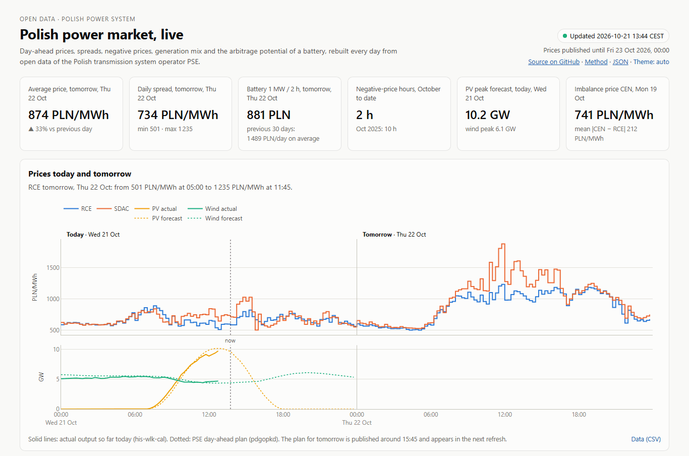
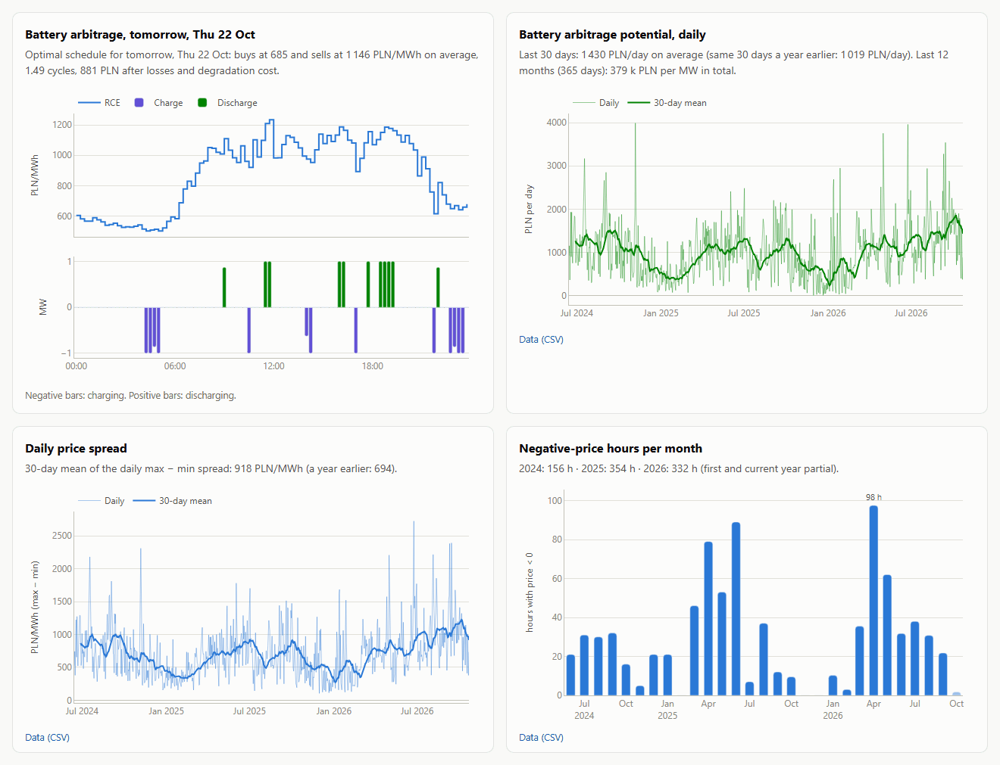
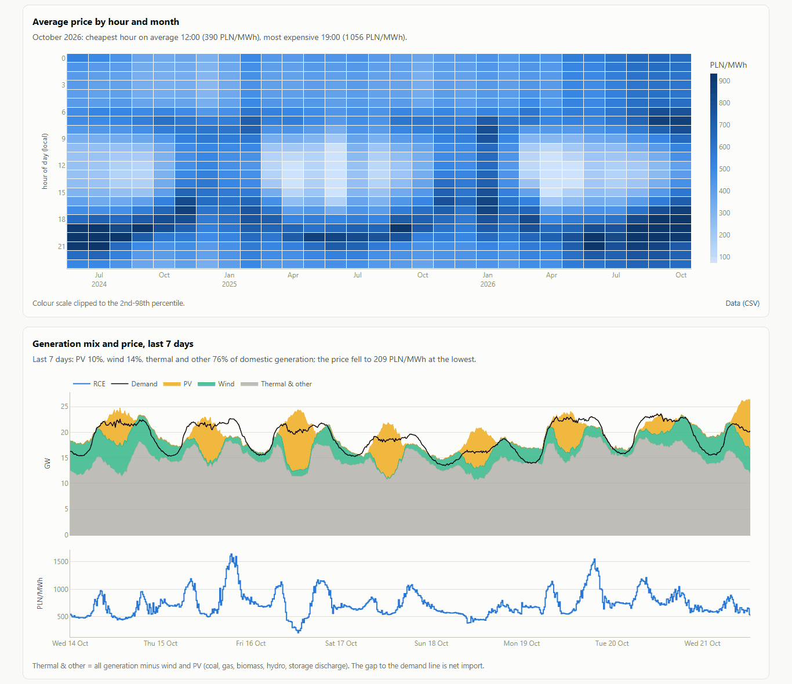
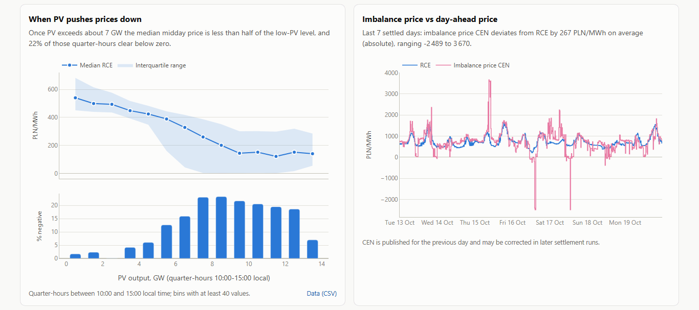
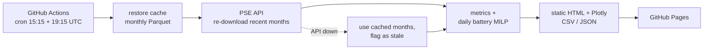

# Polish power market, live


**Live dashboard: https://kwwaleszczynski-del.github.io/pl-power-market-live/**

A self-updating dashboard of the Polish electricity market, rebuilt every afternoon by GitHub Actions from the
public API of the transmission system operator PSE and published as a static page on GitHub Pages. No server,
no database and no data in the repository: the history lives in the Actions cache as monthly Parquet files, and
each run downloads only what is new.



## What it shows

| Panel | Question it answers |
|---|---|
| KPI tiles | What do tomorrow's prices look like, and what could a battery earn on them? |
| Prices today and tomorrow | 15-minute RCE and SDAC prices with actual and forecast PV / wind output |
| Battery arbitrage | Optimal charge / discharge plan of a 1 MW / 2 MWh battery for the next delivery day, and its daily potential since June 2024 |
| Daily price spread | How wide is the daily max − min spread, and is it growing? |
| Negative-price hours | How often does the price drop below zero, month by month? |
| Price by hour and month | The solar "duck curve": cheap middays, expensive evenings |
| Generation mix and price | Last 7 days of thermal, wind and PV generation against demand and price |
| When PV pushes prices down | Midday price distribution as a function of national PV output |
| Imbalance vs day-ahead | How far the imbalance settlement price CEN strays from the day-ahead price |

Every panel has a one-line takeaway computed from the current data and a CSV download; `data/latest.json` holds
the KPI values for anyone who wants to reuse them.





## Snapshot (build of 21 October 2026)

Prices: RCE, 15 minutes, 14 June 2024 - 22 October 2026 (861 delivery days, the last one published the day
before delivery).

- **Negative prices are now routine**: 156 h in the second half of 2024, 354 h in 2025 and 332 h in 2026 to date,
  concentrated around solar noon from April to August. Prices ranged from -1458 to 3039 PLN/MWh.
- **PV sets the midday price**: with less than 3 GW of national PV output the median price between 10:00 and 15:00 is
  about 500 PLN/MWh; above 7 GW it falls to 120-260 PLN/MWh and about one in five quarter-hours clears below zero.
- **Spreads are widening**: the 30-day mean of the daily max − min spread is 918 PLN/MWh, against 694 a year earlier.
- **Battery arbitrage potential** (1 MW / 2 MWh, perfect foresight, upper bound): 308 k PLN in 2025 and already
  344 k PLN in 2026 by 22 October, and 379 k PLN in the last 12 months (23 October 2025 - 22 October 2026). The last
  30 days averaged 1 430 PLN per day, against 1 019 PLN in the same 30 days a year earlier; autumn spreads are wide,
  so a month does not scale to a year.
- **Imbalance prices are far more volatile than day-ahead prices**: over the last settled week CEN deviated from RCE
  by 267 PLN/MWh on average, with quarter-hours from -2489 to 3670 PLN/MWh.



## How it works



1. **Fetch** (`pse_api.py`): five series from `https://api.raporty.pse.pl/api` through
   [pse-opendata](https://pypi.org/project/pse-opendata/), stored as one Parquet file per report and month. A month
   is downloaded again on every run until the revision window of its report has passed (3 days for prices, 60 for
   generation, 120 for the imbalance price CEN), to pick up late publications and settlement corrections.
2. **Compute** (`metrics.py`, `arbitrage.py`): daily statistics, negative-price hours, the hour x month profile, the
   generation mix, PV bins, and the optimal daily dispatch of a battery. The optimiser is imported from the companion
   project [bess-arbitrage-pl](https://github.com/kwwaleszczynski-del/bess-arbitrage-pl) (pinned commit); solved days
   are cached by a hash of their prices, so a daily run solves only new or revised days.
3. **Render** (`figures.py`, `page.py`, `template.html`): Plotly figures embedded as JSON in one HTML page with KPI
   tiles, methodology and a data-status table. Light and dark themes use validated colour palettes; the page works on
   phones.
4. **Deploy** (`.github/workflows/dashboard.yml`): the `site/` folder is uploaded as a Pages artifact, so the
   repository never grows with data or generated HTML.

### What happens when PSE does not answer

| Situation | Result |
|---|---|
| One request fails | retried 4 times with back-off (honouring `Retry-After`) |
| API down for a series | cached months are used, the series is marked *stale* on the page and the badge turns amber |
| API down, nothing cached for a series | panels that need it show a short note; all other panels are built |
| A panel raises an unexpected error | that panel is replaced by a note, the rest of the page is published |
| No price data at all | the build exits with code 2, nothing is deployed, the previous page stays online |
| Cache evicted by GitHub | the next run downloads the full history again (about a minute) |

The workflow also re-enables itself on every scheduled run, because GitHub disables schedules in repositories without
activity for 60 days.

## Data

All series are public reports of PSE S.A. (Polskie Sieci Elektroenergetyczne), the Polish TSO, available without a
key at `https://api.raporty.pse.pl/api`. Timestamps (`dtime_utc`) mark the **end** of each 15-minute interval; the code
converts them to interval start and shows Polish local time (delivery days have 92 or 100 quarter-hours when the clocks
change).

| Key | Endpoint | Content | Published |
|---|---|---|---|
| `rce` | `rce-pln` | RCE, market price of electricity, PLN/MWh | day before delivery, ~13:45 |
| `sdac` | `csdac-pln` | price from the single day-ahead coupling (SDAC), PL zone, PLN/MWh | day before delivery |
| `mix` | `his-wlk-cal` | actual demand, wind, PV, generation in and outside the balancing market, cross-border exchange, MW | during the day |
| `fcst` | `pdgopkd` | day-ahead coordinated plan: forecast demand, wind and PV, MW | day before delivery, ~15:45 |
| `imb` | `crb-rozl` | imbalance settlement price CEN, PLN/MWh | day after delivery, corrected later |

RCE and SDAC are close but not identical; the history panels and the battery model use RCE (selectable with
`--price-series sdac`).

**Terms of use.** PSE publishes conditions for re-using public sector information
([www.pse.pl, BIP, "Ponowne wykorzystywanie informacji sektora publicznego"](https://www.pse.pl/bip/ponowne-wykorzystanie-informacji-publicznej),
entry changed on 14 October 2026, checked on 31 October 2026). They allow commercial and non-commercial re-use of
information published on www.pse.pl free of charge, on condition that the user names the source and the date the
information was obtained, removes the PSE logo, and, when the information has been processed, tells recipients that
it was changed and how, without misleading them. PSE accepts no liability for processed information and notes that
some materials may be protected by copyright or database rights. These conditions are written for www.pse.pl; this
project applies them to the reports API of the same operator. The page footer carries the attribution with the date
of each build:

> Information obtained from www.pse.pl (PSE S.A. reports `rce-pln`, `csdac-pln`, `his-wlk-cal`, `pdgopkd`,
> `crb-rozl`), state as of the build time shown on the page. The information has been processed: aggregated to daily,
> monthly and hourly statistics, combined across reports and used in a battery model. It is not an official PSE
> publication.

The repository contains no PSE data; the page and its CSV files publish derived statistics.

## Method notes

- **Daily spread**: maximum minus minimum quarter-hour price of a delivery day.
- **Negative-price hours**: quarter-hours with a price below zero, times 0.25 h.
- **Thermal & other generation**: `his-wlk-cal` reports wind and PV in total while their units appear partly among
  units active in the balancing market (`jg`) and partly outside it (`jnwrb`), so thermal & other =
  `jg + jnwrb - wind - pv` (coal, gas, biomass, hydro, storage discharge). The gap between generation and demand is
  net exchange.
- **PV vs price**: quarter-hours between 10:00 and 15:00 local time, grouped into 1 GW bins of national PV output
  (bins with at least 40 values); median price with the interquartile range and the share of negative prices.
- **Battery**: 1 MW / 2 MWh, round-trip efficiency 87 %, usable state of charge 5-95 %, at most 1.5 full cycles per
  day, degradation cost 30 PLN per MWh discharged, end-of-day state of charge equal to the start. One mixed-integer
  linear program per day (HiGHS), with perfect knowledge of that day's prices.

## Limitations

- **The battery figure is an upper bound** for pure day-ahead arbitrage: bids go in before the auction, so no operator
  knows these prices when bidding; no balancing services, intraday trading, capacity market, grid fees or taxes. See
  [bess-arbitrage-pl](https://github.com/kwwaleszczynski-del/bess-arbitrage-pl) for sensitivity to efficiency and cycle
  limits and [pl-bess-paper-trading](https://github.com/kwwaleszczynski-del/pl-bess-paper-trading) for what a forecast
  made before the gate earns (about 83 % of the upper bound in its backtest).
- **Correlation, not causation**: the PV panel shows how prices behave at different PV levels; demand, wind,
  season and cross-border flows move at the same time.
- **Revisions**: PSE corrects settlement data (notably CEN) weeks or months later. Months older than the revision
  window of their report are not downloaded again, so very late corrections are picked up only after a cache reset.
- **Schedule timing**: GitHub's cron can start runs late by tens of minutes; tomorrow's prices appear on the page
  after the first successful run following PSE's publication.
- Prices in nominal PLN; nothing on the page is investment advice.

## Run it locally

```bash
python -m venv .venv
source .venv/bin/activate        # Windows: .venv\Scripts\activate
pip install -e ".[dev]"
pytest -q
python -m pl_power_market build --out site
python -m http.server 8000 --directory site
```

The first build downloads the full history (about 7 MB of Parquet, a minute) and solves ~860 battery days
(under a minute); later builds take 10-25 seconds. `--offline` rebuilds from the cache without calling the API,
`--today 2026-10-21` fixes the reference date, `python -m pl_power_market build --help` lists all options.

### Deploy your own copy

1. Fork the repository, then in *Settings → Pages* set *Source* to **GitHub Actions**.
2. Run the **dashboard** workflow once by hand (*Actions → dashboard → Run workflow*).
3. To turn on the daily schedule, add the repository variable `DASHBOARD_SCHEDULE` = `on`
   (`gh variable set DASHBOARD_SCHEDULE --body on`). Without it, scheduled runs are skipped.

## Project layout

```
src/pl_power_market/
  pse_api.py      PSE series through pse-opendata, fault-tolerant loading, data status
  metrics.py      daily prices, spreads, negative hours, hour x month profile, generation mix, PV bins
  arbitrage.py    daily battery dispatch via bess-arbitrage-pl, cached by price hash
  figures.py      Plotly figures and the light / dark palette
  page.py         KPI tiles, panels with graceful degradation, CSV / JSON outputs
  template.html   page layout, styles and the theme-aware chart loader
  cli.py          command line interface (fetch, build)
tests/            API client, cache and failure handling, metrics, battery cache, page build (no network)
.github/workflows/
  ci.yml          tests on Python 3.11 and 3.12
  dashboard.yml   scheduled build and GitHub Pages deployment
```

## License

MIT, see [LICENSE](LICENSE). Data: PSE S.A. (public reports, raporty.pse.pl).
